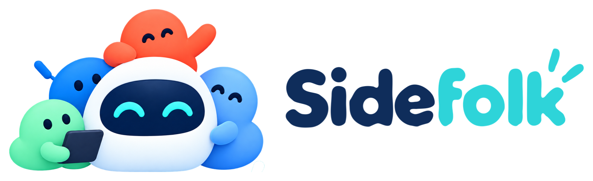

# Sidefolk

**A friendly AI companion that lives on your Mac.** A small character sits on your desktop,
remembers what you tell it, reminds you at the right moment, watches things for you, acts
through tools you allow — and other AI agents (Claude Code, Codex, any MCP client) can reach it too.

<p align="center"></p>

Mochi, the white rabbit with navy ear tips and a mint/aqua scarf, is the main mascot and the default
companion. **Settings › Companion** also offers the original Sidefolk robot with its four light
colors, and Spark. Your saved companion choice and custom name stay yours.

## What it does

- **Lives on your desktop.** The companion stands on the bottom edge of the screen, shows what it is
  doing at a glance (thinking, writing, watching, waiting for your OK, done) and gets out of the way.
  Folks from the Folk Family sit beside it while their kind of job is running: Tempo for upcoming
  reminders, Scout while watching, Byte while an agent or command runs.
- **Understands plain language without AI.** “remind me tomorrow at 9 to send the deck”, “idea: …”,
  “add oat milk to my groceries list”, “watch https://example.com/pricing”, “tell me when report.pdf
  appears in Downloads”, “quiet for 1 hour”, “what ideas did I save for Sidefolk?” all finish instantly
  on your Mac. The hint under the input tells you what Enter will do and whether it uses AI.
- **Thinks when you need it.** Questions and open-ended requests go to the AI you chose: a plan you
  already pay for (Claude through Claude Code, ChatGPT through Codex), an API key (Anthropic, OpenAI,
  Google Gemini, Mistral, Groq, xAI, DeepSeek, OpenRouter), a model on your Mac (Ollama, LM Studio),
  or your own OpenAI-compatible server. The AI acts through Sidefolk’s tools, never around them.
- **Remembers, visibly.** A Notebook with an Inbox, “About you” (facts it keeps in mind), and your
  projects, topics and lists. Everything is editable, searchable, and in the Trash for 30 days.
- **Keeps time.** Reminders with natural times and repeats, snooze, done, missed-reminder summaries,
  a morning brief, and system notifications as a fallback when Sidefolk isn’t running.
- **Watches things.** Web pages (meaningful changes only), sites going down or up, files and folders,
  processes finishing, commands you approve, and watches from extensions. A watch on
  `localhost:3000` works when you ask for it yourself.
- **Works with your agents.** `sidefolk mcp` gives Claude Code, Codex and other MCP clients a small,
  safe set of tools (save a note, set a reminder, watch, notify you, ask you). `sidefolk run -- npm test`
  tells you when a long command ends, and when it fails, the last lines it printed. Optional Claude Code hooks let the companion notice when a
  session needs you.
- **Extensible.** Install sandboxed extensions (a manifest plus any executable speaking MCP), add
  existing MCP servers, or let the companion use skills — written instructions it loads when needed.
- **You stay in control.** A deterministic Guard decides what may run — never the model. Risky actions
  ask first in plain language, files are only touched in folders you shared, outside content can’t
  quietly steer actions, and every action is in the Activity log.

## Install

Sidefolk needs macOS 15 or later. Until a signed release is published, build it yourself:

```sh
git clone <this repository> && cd sidefolk
make app            # builds build/Sidefolk.app (release)
open build/Sidefolk.app
```

Drag `build/Sidefolk.app` to `/Applications` to keep it. On first launch the companion introduces
itself in a few bubbles; choose an AI later in **Settings › AI** (everything local works without one).

## Develop

```sh
swift build                      # everything
make test                        # 851 tests (Swift Testing), serial: ~40 s
make dev                         # debug app with its own data in build/dev-home (never your real data)
swift run sidefolk-render out/   # character contact sheets for visual review
swift run SidefolkApp --ui-snapshots /tmp/sf-ui   # Home, Settings, Ask panel, bubbles; light and dark
swift scripts/dev.swift snap     # snapshot the running debug app's windows (see AGENTS.md)
```

Read [AGENTS.md](AGENTS.md) before changing things; the plan and decisions live in [docs/](docs):
[PRODUCT](docs/PRODUCT.md) · [ARCHITECTURE](docs/ARCHITECTURE.md) · [DECISIONS](docs/DECISIONS.md) ·
[SECURITY](docs/SECURITY.md) · [EXTENSIONS](docs/EXTENSIONS.md) · [CHARACTER](docs/CHARACTER.md) ·
[VOICE](docs/VOICE.md) · [STATUS](docs/STATUS.md) · [MACOS-NOTES](docs/MACOS-NOTES.md).

### Repository map

| Path | What lives there |
|------|------------------|
| `Sources/SidefolkCore/` | Everything that isn’t UI: storage, Guard, tools, brain, time, watchers, bridge, extensions, skills |
| `Sources/SidefolkCharacter/` | The Core Animation character rig, folks, icon renderer |
| `Sources/SidefolkApp/` | The app: companion window, Ask panel, bubbles, menu bar, Home, Settings, onboarding |
| `Sources/sidefolk/` | The `sidefolk` command-line helper (mcp, run, hook, status, ext validate) |
| `Tests/SidefolkCoreTests/` | Core tests |
| `extensions/` | Sample extensions (System Vitals, Hello Folk) |
| `Resources/` | Info.plist, icon, bundled skills, character sheets |
| `scripts/` | `build-app.sh` (assemble and sign the .app), `release.sh` (Developer ID, DMG, notarization), `dev.swift` (drive the debug app) |

## Release

`scripts/release.sh` runs the tests, builds, signs with hardened runtime, makes a DMG, notarizes and
staples it. It needs two things that aren’t in the repository:

```sh
export SIDEFOLK_SIGN_IDENTITY="Developer ID Application: Your Name (TEAMID)"
xcrun notarytool store-credentials sidefolk --apple-id you@example.com --team-id TEAMID
export SIDEFOLK_NOTARY_PROFILE=sidefolk
scripts/release.sh
```

## Privacy

Everything Sidefolk keeps is in `~/Library/Application Support/Sidefolk` (owner-only permissions),
logs in `~/Library/Logs/Sidefolk` (secrets redacted), API keys in your Keychain. Nothing is sent
anywhere except: requests to the AI provider you chose (Settings › AI shows exactly what was last
sent), pages you asked it to read or watch, and network access you granted to extensions. No
accounts, no telemetry. Settings › Privacy & Permissions exports or deletes everything.

## Troubleshooting

- **Nothing happens on ⌘⇧Space** — another app may use that shortcut; change it in Settings › General.
- **“That needs AI, which isn’t set up yet”** — pick a provider in Settings › AI; local commands keep working.
- **Claude Code or Codex isn’t found** — Settings › AI shows the command to install it; set a custom path
  if it’s somewhere unusual. Codex must be signed in (`codex login` in Terminal).
- **An extension “didn’t start”** — run `sidefolk ext validate <folder>`; Settings › Extensions shows
  its last error. Diagnostics (logs without your content) export from Settings › Privacy.
- **Reminders while the Mac sleeps** — the companion sleeps too; missed reminders appear once you’re back.

## Known limitations

See [docs/STATUS.md](docs/STATUS.md). In short: macOS only, English language understanding, voice
input and calendar awareness are not in V1, watchers run only while Sidefolk runs, and network-enabled
extensions can reach your local network (the sandbox can’t restrict destinations yet).

## License

Proprietary — see [LICENSE](LICENSE). Third-party components: [THIRD_PARTY_NOTICES.md](THIRD_PARTY_NOTICES.md).
