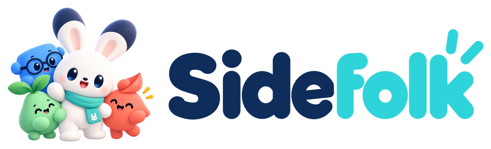
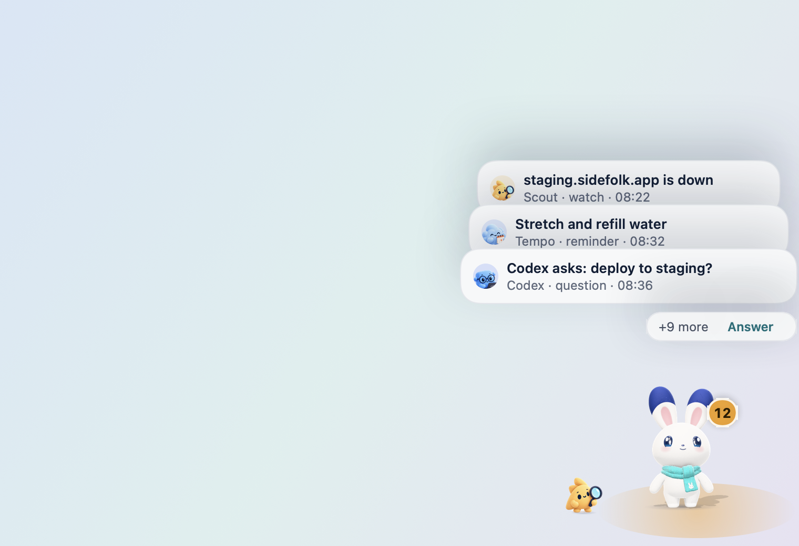
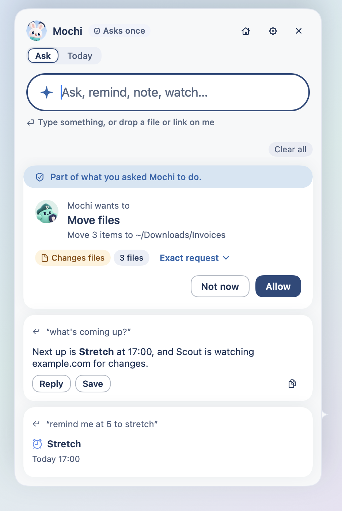
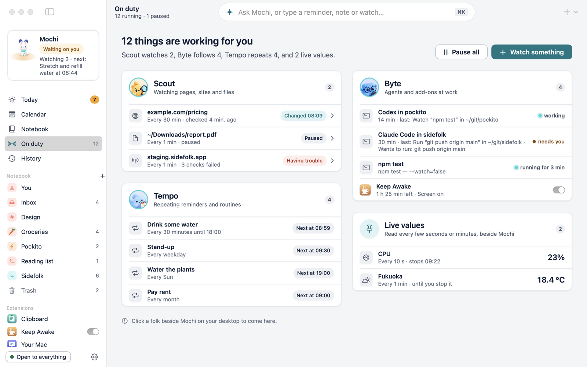
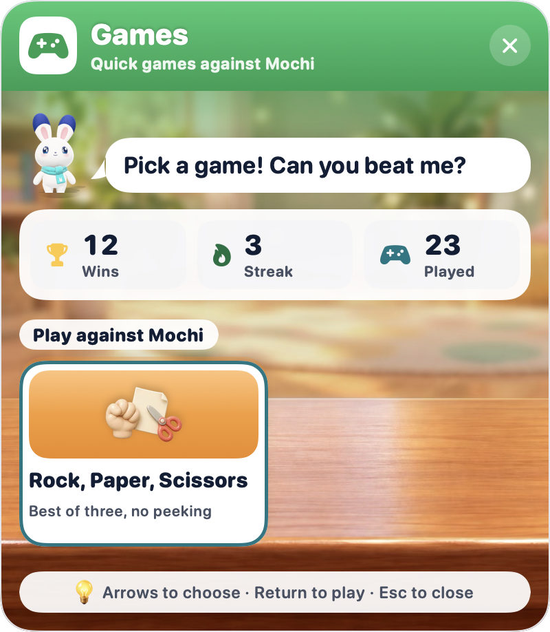

<p align="center">
  
</p>

<p align="center"><b>A small companion that lives on your Mac's desktop. It remembers, reminds and keeps watch, plays a game with you, and your AI agents can talk to it.</b></p>

<p align="center">Version 0.1.0 (snapshots) · macOS 15 or later · Apple silicon · ten languages</p>

<picture>
  <source media="(prefers-color-scheme: dark)" srcset="docs/screenshots/desktop-dark.png">
  
</picture>

Sidefolk puts a character on your desktop: Mochi the rabbit, Spark, or one of eight more from the add-on gallery.
Tell it things in plain words and it keeps them: notes, ideas, lists, reminders, pages and files to watch. All of
that works on your Mac without any AI. When you want answers or help with bigger jobs, connect the AI you already
use: Claude Code, Codex, an API key, or a model running on your own Mac.

> **0.1.0 isn't released yet.** Signed and notarized test builds ("snapshots") are on
> [Releases](https://github.com/ghassenbrg/sidefolk/releases); once installed, Sidefolk finds the next ones
> itself and asks before installing. Or [build it from source](#build-from-source). Read
> [what isn't done yet](#what-isnt-done-yet) before you rely on it.

**Contents:** [What it does](#what-it-does) · [Privacy](#privacy) · [Choosing an AI](#choosing-an-ai) ·
[Install](#install) · [Add-ons](#add-ons-companions-extensions-and-themes) · [Agents and MCP](#agents-and-mcp) ·
[What isn't done yet](#what-isnt-done-yet) · [FAQ](#faq) · [Develop](#develop) ·
[Licence and credits](#licence-credits-and-trademarks)

## What it does

### It lives on your desktop

The companion stands on its own small light at the bottom of your screen. The light says how things are: aqua while
it works, amber when something waits for you (with a count on its shoulder), grey in Focus, out in Quiet. Between
tasks it has a life of its own (a stretch, a yawn, a glance at your work) and it sits, then lies down, when nothing
happens. Click it, stroke it with the pointer, drag and throw it. It holds still while you type and uses little CPU
at rest; **Settings › Companion › Liveliness** goes from *Minimal* to *Lively*, and Reduce Motion is respected.

Everything it says is one kind of card beside it, the **Sidecard**: a short whisper for news that fades by itself,
a card when something needs an answer (it folds into the count after 30 seconds), and a permission slip when it wants
to do something you haven't allowed. Small folks stand beside it while their job runs (Tempo for reminders, Scout
for watches, Byte for agents), and live values sit beside it as pins.

Pick a companion, its size, how lively it is and where it lives (always, only when needed, or in the menu bar) in
**Settings › Companion**. Mochi and Spark are built in, in 3D or 2D; Ember, Kiko, Nimbo, Folio, Iris, Nori, Purl and
Rune come from the gallery. You can also make your own: a folder with a `species.json` and SVG shapes, read as data
and never run (`companions/template/` and Miso, a cat, show how).

### Ask in plain words, no AI needed for the basics

Click the companion or press **⌘⇧Space** and type, or use the Say bar at the top of Home (**⌘K**):

- `remind me tomorrow at 9 to send the deck` · `remind me every weekday at 9 to do standup`
- `idea: extensions could bring their own folk` · `add oat milk to my groceries list`
- `watch example.com/pricing` · `tell me when report.pdf appears in Downloads`
- `tell me the CPU every 10 seconds` · `temperature in Fukuoka every minute` · `time in Tokyo`

These finish on your Mac in a moment, without AI. The line under the field says what Return will do and whether it
uses AI (⌘Return always asks the AI, ⌥Return saves a note). Every request ends in a card (a saved note, a reminder,
an answer, a question for you), not a chat log, and most can be undone. Drop a file, a link or some text on the
companion to save it, watch it or ask about it.

<p align="center"></p>

### Home: your day, your notes, what's running, what happened

- **Today:** what needs you, what's on duty, your day as a line (with your calendar if you turn it on), what you
  captured.
- **Calendar:** reminders and calendar events as an agenda, a week or a month.
- **Notebook:** an Inbox, your projects, topics and lists of notes, ideas, tasks and links, **You** (the facts it
  keeps in mind about you, which you can read, edit and forget) and the Trash (30 days).
- **On duty:** every watch, live value, repeating reminder, agent session and extension at work, with Pause and Stop.
- **History:** every action (who asked, what was decided, what happened, Undo where it can), your conversations
  with the AI, and what Sidefolk told you.
- **Extension pages** and the **Gallery** of add-ons.

<p align="center"></p>

### It reminds you, and keeps watch

- **Reminders** with natural times and repeats down to every minute, snooze, done, a summary of what you missed, and
  a morning brief. When Sidefolk is quit, macOS notifications stand in.
- **Watches:** a web page (meaningful changes only), a site going down or coming back, a file appearing or changing,
  a new file in a folder, a program finishing, or a command you approved.
- **Live values:** a number told every few seconds or minutes (CPU, memory, battery, disk, network, the weather
  somewhere, one value on a page or API).
- **Focus and Quiet:** Focus keeps the small news for later and gives it back as one card; Quiet holds everything
  but the urgent. Both can end by themselves, and quiet hours can come every night (**Settings › Attention**).

### Games

With Playtime from the gallery, the companion plays with you in a small panel beside it: Tic-tac-toe, Copy Me, Quick
Paws, Which Cup?, Higher or Lower, Guess My Animal, Balloon Words, Last Stick, Memory Pairs, Daily Word and trivia,
and four puzzles to solve alone (Garden Plots, Seesaw, Sudoku, Blossoms) with a daily board, hints and best times.
No AI, in all ten languages.

<p align="center"></p>

### More

- **Apple Notes and Reminders:** with an AI connected, it can copy your Apple Notes into the notebook, organized, and
  read your open reminders. It removes a note from Notes only when you ask, after a whole copy, asking every time.
- **Voice, if you want it** (**Settings › Brain › Voice**): hold the Ask shortcut, talk, let go. Speech is
  recognised on your Mac and never kept; it answers in one short spoken line.
- **Themes** dress the app (colours, type, density): Harbor, Night Shift, Marshmallow and Field Notes built in, more
  in the gallery, or your own (`sidefolk theme new`).

### You decide how much it asks

A fixed set of rules, Guard, decides what may run, never the AI. Choose how often it asks before its own AI acts in
**Settings › Trust**: **Ask every time**, **Ask once per kind** (the default), **Auto** or **Full access** (which can
end by itself, in an hour or tonight). In every mode, files are touched only in folders you shared, deleting means
the Trash, anything a web page, file or extension could have steered still asks before it could send your data out,
and other agents and extensions keep stricter rules. Approvals from another app never take Return: they need ⌘Return
or a click.

## Privacy

Sidefolk is local first. Everything it keeps is in one folder on your Mac. There is no account, no telemetry, no
analytics and no crash reporter.

**What leaves your Mac, and when:**

| What | Where it goes | When |
|---|---|---|
| Your request and its context: your words, the date and time zone, your town if you set your location, the name of the app in front, what it keeps about you, notes that match, what's running, and the last few minutes of the conversation | The AI you chose: Anthropic or OpenAI through Claude Code or Codex (your account), an API provider, or nowhere if it's Ollama or LM Studio on your Mac | Only for requests that need AI. **Settings › Brain** shows exactly what was last sent. |
| A request for the page | That site | When you ask it to read or watch a page or a site, or when its AI wants to read a page to answer you (an address you didn't type asks you first, unless you chose Auto or Full access or allowed that site) |
| The place you asked about, or your own town's coordinates (rounded) | Open-Meteo (no account, no key) | When you ask for the weather |
| Sidefolk's version | GitHub | Once a day while update checks are on, and when you click Check for Updates… |
| The gallery's catalog and the add-ons you pick | GitHub | When you open the Gallery, pick an add-on, or add-ons look for updates |
| A request for the list of models, or one tiny test prompt | Your AI provider | When you pick a provider in Settings, or click **Test** |
| The words your companion says aloud | ElevenLabs, with your key | Only if you choose an ElevenLabs voice |
| Whatever that extension sends | The internet | Only extensions whose install sheet said they use the internet |
| Whatever that server does | Anywhere | MCP servers you add yourself run outside Sidefolk's sandbox, and are labelled so |

What stays on your Mac: your data in `~/Library/Application Support/Sidefolk` (readable only by you), logs in
`~/Library/Logs/Sidefolk` (7 days, secrets taken out), API keys in your Keychain. Conversations are kept 7 days (you
choose how long) and can be deleted from History. Sidefolk never reads your screen or other apps' windows; it knows
the *name* of the app in front. **Settings › Trust** exports everything as JSON or deletes everything, Keychain items
included. How it protects you from prompt injection, rogue extensions and other agents: [docs/SECURITY.md](docs/SECURITY.md).

## Choosing an AI

You don't need one. Notes, reminders, watches, live values, the calendar, games, search and the drop buttons work
without AI. Questions and open-ended requests ("organise my Downloads") need one. Pick it in **Settings › Brain**:

| How you pay | Choices | What to know |
|---|---|---|
| Nothing | No AI | Everything above that says "no AI" keeps working. |
| A plan you already have | **Claude Code** (your Claude subscription), **Codex** (your ChatGPT plan) | No API key. Their own tools are switched off: they act only through Sidefolk's tools, so every action goes through the same checks. Uses your plan's quota. |
| An API key | Anthropic, OpenAI, Google Gemini, Mistral, Groq, xAI, DeepSeek, OpenRouter | Each key is kept in your Keychain and only ever sent to its own service. |
| This Mac | Ollama, LM Studio | Nothing leaves your Mac. |
| Your own server | Any OpenAI-compatible address | With or without a key. |

Each choice has an everyday model and an optional "Think harder" model, each with its own reasoning effort where the
model accepts one. **Test** sends one tiny real request.

## Install

**Requirements:** a Mac with Apple silicon and macOS 15 or later. Optional: the `claude` or `codex` command signed
in, an API key, or Ollama or LM Studio for AI; git (`xcode-select --install`) for the Git extension; macOS 26 for
Apple's newer speech recognition.

**Download:** the latest snapshot's disk image is on [Releases](https://github.com/ghassenbrg/sidefolk/releases),
signed with a Developer ID and notarized.

### Build from source

You need Xcode 26 or later (Swift 6.2).

```sh
git clone https://github.com/ghassenbrg/sidefolk.git
cd sidefolk
make app                 # builds build/Sidefolk.app (release)
open build/Sidefolk.app
```

The build is signed with your "Apple Development" certificate if you have one, otherwise ad hoc; with an ad-hoc
build, macOS forgets the microphone and Automation permissions each time you rebuild.

**First launch:** the companion says hello on the desktop, sets a real reminder two minutes out (no AI involved),
asks for notifications when it first needs them, offers to open at login, and points to Settings › Connections if
it finds Claude Code or Codex. Choose an AI later, when you first need one.

## Add-ons: companions, extensions and themes

Home's **Gallery** lists what Sidefolk's developer publishes in [sidefolk-addons](https://github.com/ghassenbrg/sidefolk-addons):
companions, extensions (Git, Currency, Playtime, Images, PDF Tools, QR Codes, Archives, Dev Toolbox, Feeds, Your Mac,
Clipboard, Keep Awake, Miraya) and themes. Each is downloaded only when you pick it, as a pack signed by the
developer, and Sidefolk checks the signature before using it. Add-ons update by themselves when they ask for nothing
new; otherwise they wait for your look.

Extensions give your companion new tools, things to watch, pages in Home, tiles on Today, palettes and games. An
extension is a folder with a manifest and a small program that speaks [MCP](https://modelcontextprotocol.io).
Sidefolk runs it in a macOS sandbox built from what the manifest asks for, and shows you those permissions in plain
words before you install it.

- **Built in:** World Clock, Calculator, System Vitals and Weather (only the place you ask about goes to Open-Meteo).
- **Install one from a folder:** Settings › Add-ons › Install from folder…, or drop the folder on the companion.
- **Add an MCP server you already use:** Settings › Add-ons › Add MCP Server…. It runs outside the sandbox and is
  labelled that way.
- **Ask Sidefolk to write one:** with an AI connected, ask for something it can't do yet. It describes the
  extension, waits for your yes, writes a text-only draft, tries it with every permission removed, and shows you the
  normal install sheet. Nothing is installed until you click Install.
- **Write your own:** [docs/EXTENSIONS.md](docs/EXTENSIONS.md), the samples in [extensions/](extensions), and the
  [`sidefolk-extension` skill](skills/sidefolk-extension/SKILL.md) for Claude Code or Codex.

## Agents and MCP

Sidefolk is also a small MCP server, so Claude Code, Codex or any MCP client can leave you a note, change or trash
one, set a reminder, watch something, show a live value, tell you something or ask you a question. Set it up in
**Settings › Connections**:

- **Connect** Claude Code or Codex: it adds a `sidefolk` server and the Sidefolk skill to their settings, shows every
  change first, saves a backup next to each file, and Disconnect removes only what it added.
- **Sessions:** with hooks turned on, the companion tells you when a Claude Code or Codex session needs you, and
  shows working sessions as small faces beside it.
- **Long commands:** install the `sidefolk` command, then `sidefolk run -- npm test`; the companion tells you when it
  ends, and when it fails, the last lines it printed.
- **Any other MCP client:** run `sidefolk mcp` over stdio; Settings › Connections › Other apps has the snippet.

What other agents may do (save, change, read) is yours to set in **Settings › Trust**. Reading your notes or
reminders asks you first by default. Files, the clipboard, the web, commands, settings and extensions are never
offered to them, and they can never answer an approval.

## What isn't done yet

- **Snapshots only.** 0.1.0 isn't released, and its licence isn't chosen yet.
- **Apple silicon only**, and most testing has been on macOS 27.
- **Mail, Music and Shortcuts** can't be reached; the calendar is read only. Scheduled AI routines ("every weekday
  at 9, give me my open tasks") aren't built.
- **Watches and live values run only while Sidefolk runs.** Reminders fall back to macOS notifications when it's quit.
- **Extensions** can use the whole internet or none of it (not chosen sites) and can't keep an API key yet.
- **The quick understanding without AI reads English only**; with an AI connected, ask in any language.
- **Not yet tried by hand:** voice with a real microphone, Claude Code hooks in a real session, several displays.

The full, current list is in [docs/STATUS.md](docs/STATUS.md).

## FAQ

**Will it spend my Claude or ChatGPT quota?** Only for requests that need AI. The line under the field says "no AI"
when Return won't use any.

**Does it watch my screen or listen all the time?** No. It never reads your screen or other apps' windows. The
microphone is off unless you turned voice on and are holding the key.

**Can it delete my files?** It works only in folders you share with it, asks before changing things (unless you chose
otherwise), and "deleting" moves things to the Trash. Every action is in History, and most can be undone.

**What happens if a web page tries to give it instructions?** Anything Sidefolk reads from outside (pages, files,
notes, extension output) marks the request as untrusted, and from then on anything that could change things or send
data out asks you first, in every mode. See [docs/SECURITY.md](docs/SECURITY.md).

**Does it change my Claude Code or Codex settings?** Only when you click Connect, after showing you every change,
with a backup next to each file.

**Intel Macs, Windows, Linux, iPhone?** Not now. Sidefolk is a native Mac app built for Apple silicon.

**Troubleshooting.** Nothing on ⌘⇧Space: another app may use it; change it in Settings › General. "That needs AI":
pick a provider in Settings › Brain. An extension "didn't start": `sidefolk ext validate <folder>`, and Settings ›
Add-ons shows its last error. Diagnostics (logs without your content) export from Settings › Trust.

## Develop

```sh
swift build                      # everything
make test                        # the test suite (Swift Testing), serially
make dev                         # debug app with its own data in build/dev-home (never your real data)
swift run sidefolk-render out/   # character contact sheets for visual review
SIDEFOLK_RESOURCES=$PWD/Resources swift run SidefolkApp --ui-snapshots /tmp/sf-ui   # every screen, light and dark
make strings                     # collect every string people read into the catalog
swift scripts/dev.swift snap     # snapshot the running debug app's windows (see AGENTS.md)
```

Read [AGENTS.md](AGENTS.md) before changing things. The plan and the decisions live in [docs/](docs):
[STATUS](docs/STATUS.md) · [PRODUCT](docs/PRODUCT.md) · [ARCHITECTURE](docs/ARCHITECTURE.md) ·
[DESIGN](docs/DESIGN.md) · [DECISIONS](docs/DECISIONS.md) · [SECURITY](docs/SECURITY.md) ·
[EXTENSIONS](docs/EXTENSIONS.md) · [CHARACTER](docs/CHARACTER.md) · [VOICE](docs/VOICE.md) ·
[MACOS-NOTES](docs/MACOS-NOTES.md) · [RELEASE](docs/RELEASE.md) · [HISTORY](docs/HISTORY.md).

| Path | What lives there |
|------|------------------|
| `Sources/SidefolkCore/` | Everything that isn't UI: storage, Guard, tools, brain, time, watchers, attention, bridge, extensions, updates, voice, the Mac's own apps |
| `Sources/SidefolkCharacter/` | The 2D rigs for every companion and folk, custom companions as data, the icon renderer |
| `Sources/SidefolkApp/` | The app: the companion and its Sidecard, Ask, the Play panel, Home, Settings, the Pocket, onboarding, voice |
| `Sources/sidefolk/` | The `sidefolk` command-line helper (mcp, run, hook, status, ext validate, theme) |
| `Resources/Companions3D/` | The three.js engine and the built-in 3D companions; `companions-3d/` and `companions-2d/` hold the pipelines |
| `extensions/` | The built-in extensions, a sample, and the Kit they are written on |
| `skills/` | The skill Connect gives other agents, and the `sidefolk-extension` skill |
| `scripts/` | `build-app.sh`, `release.sh`, `dev.swift` (drive the debug app), strings and brand tools |

**Release:** on GitHub, **CI** builds and tests every push and pull request to `main`, and **Release** (Actions ›
Release › Run workflow) publishes a signed, notarized snapshot or, from a `v<version>` tag, a production release.
`scripts/release.sh` does the same on a Mac with a Developer ID: [docs/RELEASE.md](docs/RELEASE.md).

## Licence, credits and trademarks

**Licence.** Sidefolk is © 2026 Ghassen Bargougui, all rights reserved ([LICENSE](LICENSE)). The code is public to
read; a licence for using and changing it hasn't been chosen yet.

**Built with** [GRDB.swift](https://github.com/groue/GRDB.swift) by Gwendal Roué and
[KeyboardShortcuts](https://github.com/sindresorhus/KeyboardShortcuts) by Sindre Sorhus (both MIT), and
[three.js](https://threejs.org) (MIT) for the 3D companions. Service logos in Settings come from
[LobeHub Icons](https://github.com/lobehub/lobe-icons) (MIT). Weather data by [Open-Meteo.com](https://open-meteo.com)
(CC BY 4.0). Full notices: [THIRD_PARTY_NOTICES.md](THIRD_PARTY_NOTICES.md).

**Trademarks.** Sidefolk, Mochi and the Folk Family characters belong to Sidefolk's author. Claude and Claude Code
are trademarks of Anthropic; ChatGPT, Codex and OpenAI of OpenAI; Apple, Mac, macOS and Apple Notes of Apple; other
names and logos belong to their owners. They are used only to say which service Sidefolk connects to. Sidefolk is not
affiliated with or endorsed by any of them.
