<p align="center">
  
</p>

<p align="center"><b>A small companion that lives on your Mac's desktop. It remembers, reminds and keeps watch, and your AI agents can talk to it.</b></p>

<p align="center">Version 0.1.0 · macOS 15 or later · Apple silicon · ten languages</p>

<picture>
  <source media="(prefers-color-scheme: dark)" srcset="docs/launch/screenshots/hero-dark.png">
  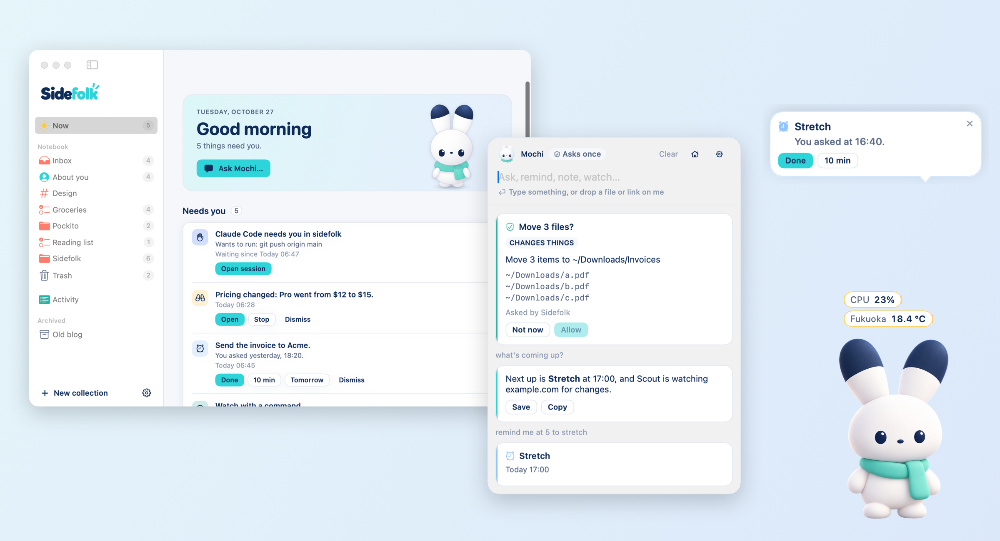
</picture>

Sidefolk puts a character on your desktop: Mochi the rabbit, or one of twelve others. Tell it things
in plain words and it keeps them: notes, ideas, lists, reminders, pages and files to watch. All of
that works on your Mac without any AI. When you want answers or help with bigger jobs, connect the
AI you already use: Claude Code, Codex, an API key, or a model running on your own Mac.

> **0.1.0 is the first release.** There is no signed download yet, so for now you
> [build it from source](#build-from-source). Read [what isn't done yet](#what-isnt-done-yet) before
> you rely on it.

**Contents:** [What it does](#what-it-does) · [Privacy](#privacy) · [Choosing an AI](#choosing-an-ai) ·
[Install](#install) · [Extensions](#extensions) · [Agents and MCP](#agents-and-mcp) ·
[Languages](#languages) · [What isn't done yet](#what-isnt-done-yet) · [FAQ](#faq) ·
[Develop](#develop) · [Licence and credits](#licence-credits-and-trademarks)

## What it does

### It lives on your desktop

The companion stands on the bottom edge of your screen and shows what it is doing: thinking, writing,
watching, waiting for your OK, done. When a reminder is close, a page is being watched or an agent is
working, a small folk sits beside it (Tempo, Scout, Byte). Between tasks it has a life of its own:
now and then a stretch, a yawn, an ear twitch or a glance at your work, and it sits, then lies down,
when nothing happens. Click it for a boop, stroke it with the pointer to pet it, drag it and drop or
throw it. It holds still while you type, and at rest it uses well under 0.1 % of one CPU core.
**Settings › Companion › Liveliness** goes from *Minimal* (moves only when something happens) to
*Lively*; *Balanced* is the default, and Reduce Motion is respected. If "always there" is too much,
choose *Only when needed* or *Menu bar only*.

<p align="center">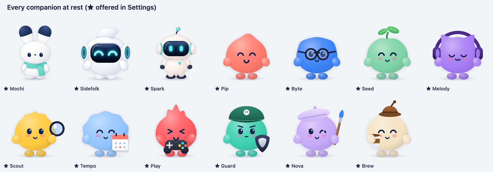</p>

Pick your companion in **Settings › Companion**, name it, and give it a colour and a scarf. Every
companion is drawn live, so each one has every pose: listening, thinking, working with a prop that
says what it's doing, waiting, happy, worried, asleep. You can also make your own: a companion is a
folder with a `species.json` and SVG shapes, read as data and never run (`companions/template/` and
Miso, a cat, show how; they appear under *Made by you*).

### Ask in plain words, no AI needed for the basics

Click the companion or press **⌘⇧Space** and type:

- `remind me tomorrow at 9 to send the deck` · `remind me every weekday at 9 to do standup` ·
  `remind me every 10 minutes until 6pm to drink water`
- `idea: extensions could bring their own folk` · `add oat milk to my groceries list`
- `watch example.com/pricing` · `tell me when report.pdf appears in Downloads` ·
  `tell me when localhost:3000 is back up`
- `tell me the CPU every 10 seconds` · `temperature in Fukuoka every minute`
- `quiet for 1 hour` · `what ideas did I save for Sidefolk?`

These finish on your Mac in a moment, without AI. The line under the box tells you what Enter will do
and whether it uses AI. Every request ends in a card (a saved note, a reminder, an answer, a question
for you), not a chat log, and most can be undone. You can also drop a file, a link or some text on the
companion and choose Save, Remind me…, Watch or Ask.

<p align="center">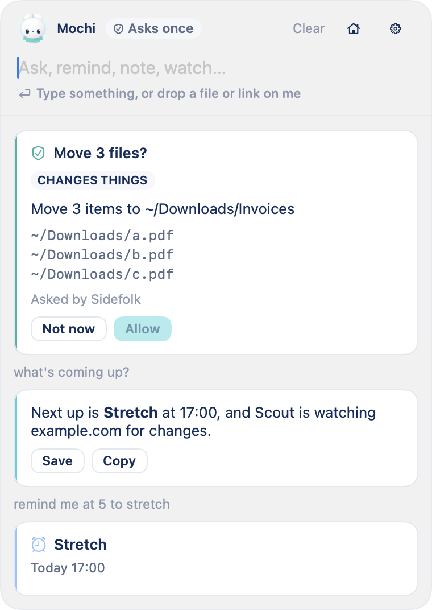</p>

### It remembers, where you can see it

The **Notebook** has an Inbox, **About you** (facts it keeps in mind about you, which you can read and
change), and your own projects, topics and lists of notes, ideas, tasks and links. Search everything
with ⌘F. Deleted things stay in the Trash for 30 days. Notes an agent saved say which one.

<p align="center">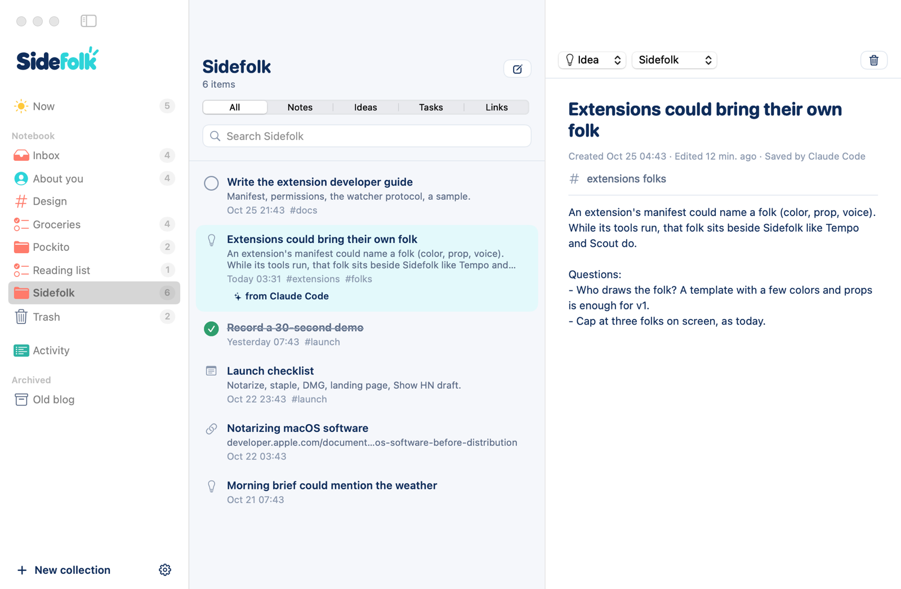</p>

### It reminds you, and keeps watch

- **Reminders** with natural times and repeats down to every minute, snooze, done, a summary of what
  you missed, and a morning brief. When Sidefolk is quit, macOS notifications stand in.
- **Watches**: a web page (meaningful changes only), a site going down or coming back, a file appearing
  or changing, a new file in a folder, a program finishing, or a command you approved.
- **Live values**: a number told every few seconds or minutes (CPU, memory, battery, disk, network, the
  weather somewhere, one value on a page or API) shows in a small pill beside the companion and on Now.

<p align="center">
  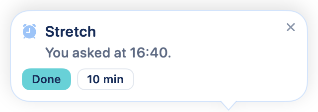
  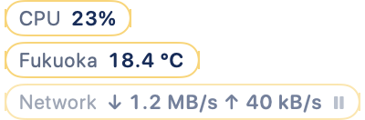
</p>

### Now, and everything it did

**Now** shows what needs you, live values, what's running, what's coming up and what's being watched.
**Activity** lists every action: who asked (you, your companion, Claude Code, an extension), how risky
it was, what was decided and what happened, with Undo for the last 15 minutes.

<p align="center">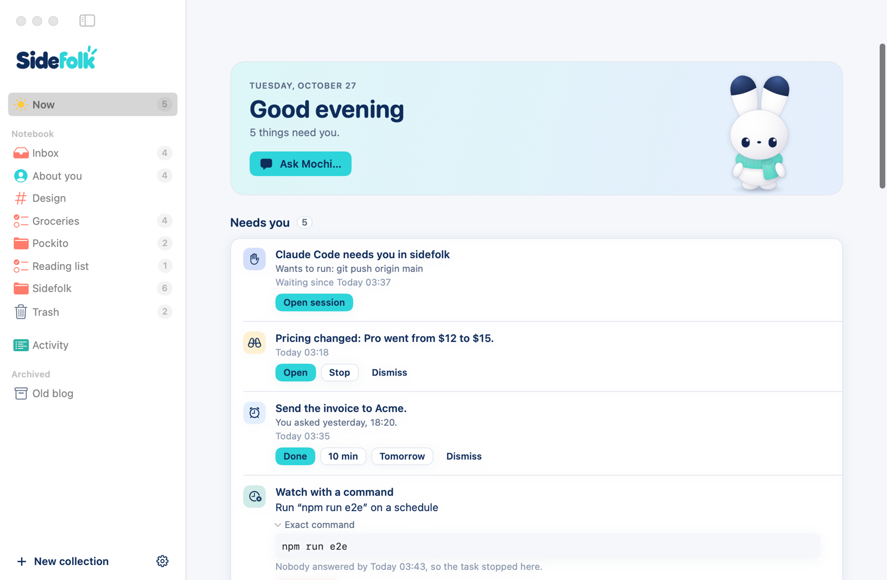</p>
<p align="center">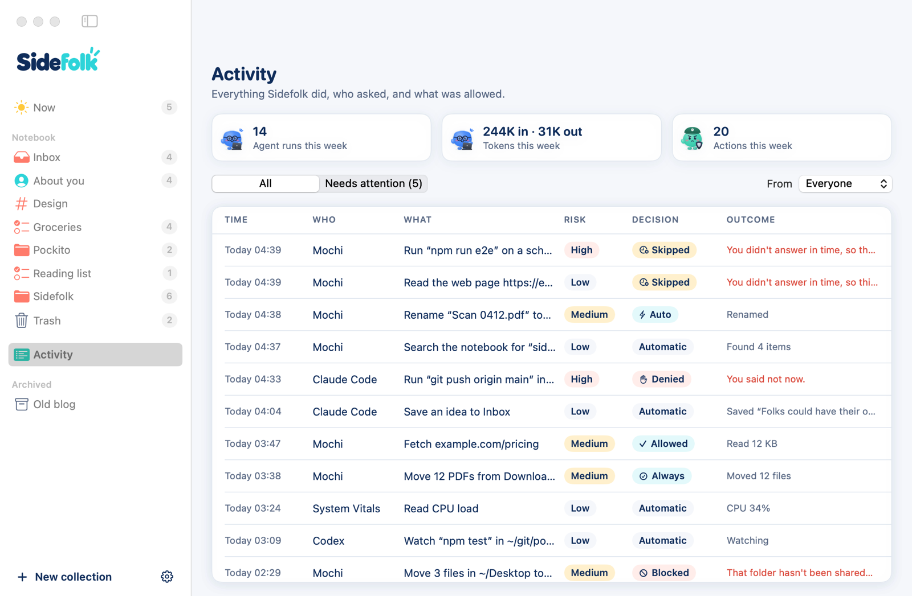</p>

### It works with Apple Notes

With an AI connected, ask "check my Apple Notes and move them, well organized, into the notebook".
Sidefolk lists, reads and copies your notes in batches of up to 50, keeps their dates, and remembers
which ones are copied, so a big library can be done over a few requests. It removes a note from Notes
only if you ask, only after a whole copy, and asks you every time. It can also read your open Apple
Reminders. macOS asks you once before Sidefolk can talk to Notes or Reminders.

<p align="center">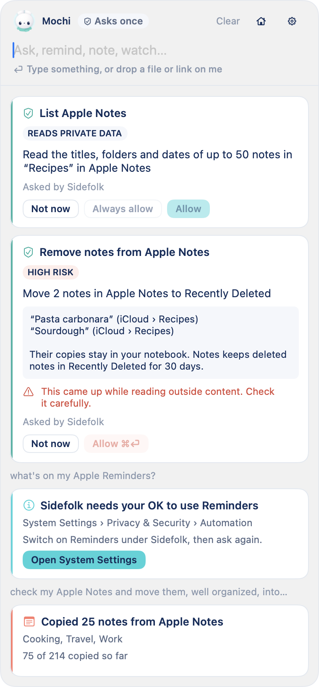</p>

### It listens and talks, if you want

Off until you switch it on in **Settings › Voice**. Hold the Ask shortcut (or press and hold the
companion), talk, and let go to send. What you say is understood on your Mac by Apple's speech
recognition; the microphone is on only while you hold the key, and the recording is never kept. The
companion answers in one short spoken line, by default only when you spoke. Voices: Apple's, made on
your Mac, or ElevenLabs with your own key.

<p align="center">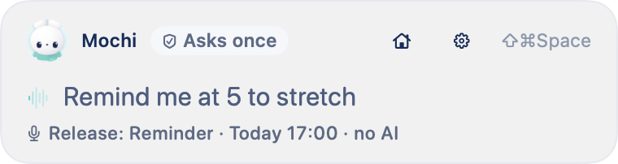</p>

### You decide how much it asks

A fixed set of rules, not the AI, decides what may run. Choose how often Sidefolk asks before its own
AI acts: **Ask every time**, **Ask once per kind** (the default), **Auto** or **Full access**. In every
mode, files are touched only in folders you shared, deleting means the Trash, anything a web page,
file or extension could have steered still asks before it could send your data out, and other agents
and extensions keep stricter rules. If you don't answer, the task skips that step after 10 minutes (or
waits, or stops; your choice) and the step waits on Now with **Run it now**.

<p align="center">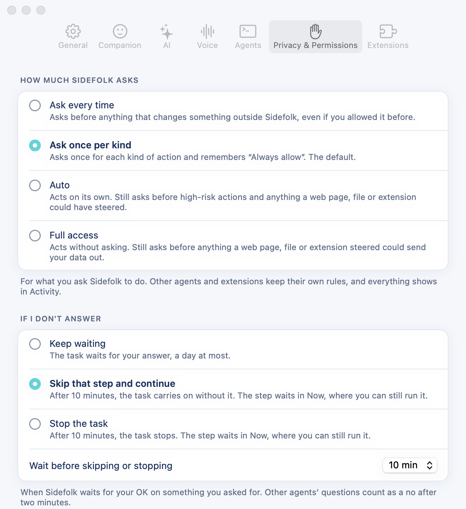</p>

## Privacy

Sidefolk is local first. Everything it keeps is in one folder on your Mac. There is no account, no
telemetry, no analytics, no crash reporter and no update check.

**What leaves your Mac, and when:**

| What | Where it goes | When |
|---|---|---|
| Your request and its context: your words, the date and time zone, the name of the app in front, your "About you" notes, notes that match, what's running, and the last few minutes of the conversation | The AI you chose: Anthropic or OpenAI through Claude Code or Codex (your account), an API provider, or nowhere if it's Ollama or LM Studio on your Mac | Only for requests that need AI. **Settings › AI** shows exactly what was last sent. |
| A request for the page | That site | When you ask it to read or watch a page or a site, or when its AI wants to read a page to answer you (an address you didn't type asks you first, unless you chose Auto or Full access or allowed that site) |
| The place you asked about | Open-Meteo (no account, no key) | When you ask for the weather |
| A request for the list of models, or one tiny test prompt | Your AI provider | When you pick a provider in Settings, or click **Test** |
| The words your companion says aloud | ElevenLabs (api.elevenlabs.io), with your key | Only if you choose an ElevenLabs voice |
| Whatever that extension sends | The internet | Only extensions you allowed to use the internet. The built-in Git extension clones the repositories you ask for. |
| Whatever that server does | Anywhere | MCP servers you add yourself run outside Sidefolk's sandbox, and are labelled so |

What stays on your Mac:

- Your data: `~/Library/Application Support/Sidefolk` (readable only by you). Logs:
  `~/Library/Logs/Sidefolk`, kept 7 days, with secrets taken out. API keys: your Keychain.
- Recent conversation is kept 7 days to answer follow-ups, and never shown as a transcript.
- Voice: speech is recognised on your Mac; the audio is never stored. (macOS may download a language's
  speech model from Apple the first time.)
- Sidefolk never reads your screen or other apps' windows. It knows the *name* of the app in front.
- **Settings › Privacy & Permissions** exports everything (JSON) or deletes everything, Keychain items
  included.

How it protects you from prompt injection, rogue extensions and other agents is written up in
[docs/SECURITY.md](docs/SECURITY.md).

## Choosing an AI

You don't need one. Notes, reminders, watches, live values, quiet mode, search and the drop buttons
all work without AI. Questions and open-ended requests ("organise my Downloads", "which of my launch notes
should I do first?") need one. Pick it in **Settings › AI**:

| How you pay | Choices | What to know |
|---|---|---|
| Nothing | No AI | Everything above that says "no AI" keeps working. |
| A plan you already have | **Claude Code** (your Claude subscription), **Codex** (your ChatGPT plan) | No API key. Their own tools (shell, file edits, browser) are switched off: they can act only through Sidefolk's tools, so every action goes through the same checks. Uses your plan's quota. |
| An API key | Anthropic, OpenAI, Google Gemini, Mistral, Groq, xAI, DeepSeek, OpenRouter | Each key is kept in your Keychain and only ever sent to its own service. |
| This Mac | Ollama, LM Studio | Nothing leaves your Mac. |
| Your own server | Any OpenAI-compatible address | With or without a key. |

Each choice has an everyday model and an optional "Think harder" model, each with its own reasoning
effort where the model accepts one. **Test** sends one tiny real request.

<p align="center">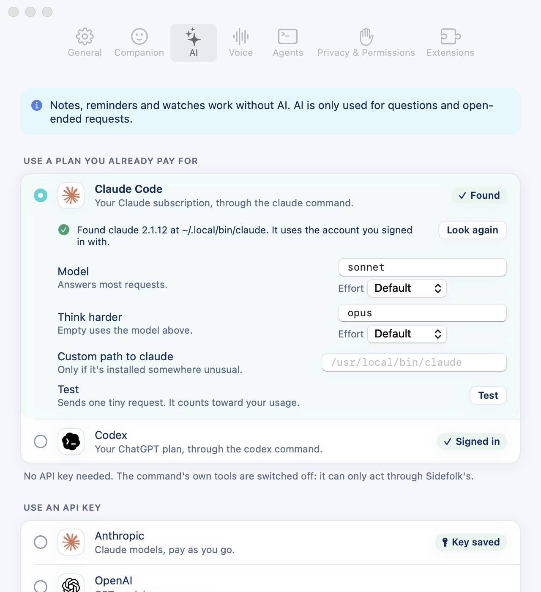</p>

## Install

### Requirements

- A Mac with Apple silicon, macOS 15 or later.
- Optional, for AI: the `claude` or `codex` command signed in, an API key, or Ollama or LM Studio.
- Optional, for the built-in extensions (Git, World Clock, System Vitals, Weather): Python 3 and git
  from Apple's Command Line Tools (`xcode-select --install`) or Homebrew. Without them, Settings ›
  Extensions says what's missing; everything else works.
- Optional, for voice: macOS 26 or later for Apple's newer speech recognition. macOS 15 uses the older
  on-device recognizer, labelled "basic".

### Download

There is no signed, notarized download yet. Until there is, build it yourself.

### Build from source

You need Xcode 26 or later (Swift 6.2).

```sh
git clone https://github.com/ghassenbrg/sidefolk.git
cd sidefolk
make app                 # builds build/Sidefolk.app (release)
open build/Sidefolk.app
```

Drag `build/Sidefolk.app` to `/Applications` to keep it. The build is signed with your "Apple
Development" certificate if you have one, otherwise ad hoc; with an ad-hoc build, macOS forgets the
microphone and Automation permissions each time you rebuild.

### First launch

The companion says hello in a few bubbles, offers to connect Claude Code and Codex if it finds them,
sets a real reminder two minutes out (no AI involved), asks for notifications when it first needs
them, and offers to open at login. Choose an AI later, when you first need one.

## Extensions

Extensions give your companion new tools and new things to watch. An extension is a folder with a
manifest and a small program that speaks [MCP](https://modelcontextprotocol.io). Sidefolk runs it in a
macOS sandbox built from what the manifest asks for, and shows you those permissions in plain words
before you install it.

- **Built in:** Git (clone a public repository into a folder you name, status, pull, log), World Clock,
  System Vitals and Weather (forecasts and a rain watcher; only the place you ask about goes to
  Open-Meteo). All four start on, and you can switch any of them off.
- **Install one:** Settings › Extensions › Install from folder…, or drop the folder on the companion.
- **Add an MCP server you already use:** Settings › Extensions › Add MCP Server. It runs outside the
  sandbox and is labelled that way.
- **Ask Sidefolk to write one:** with an AI connected, ask for something it can't do yet. It describes
  the extension, waits for your yes, writes a text-only draft, tries it with every permission removed,
  and then shows you the normal install sheet ("written by Sidefolk for you", with Show Files). Nothing
  is installed until you click Install.
- **Write your own:** [docs/EXTENSIONS.md](docs/EXTENSIONS.md), the samples in [extensions/](extensions),
  and the [`sidefolk-extension` skill](skills/sidefolk-extension/SKILL.md) for Claude Code or Codex,
  with Python, Node and sh templates.

<p align="center">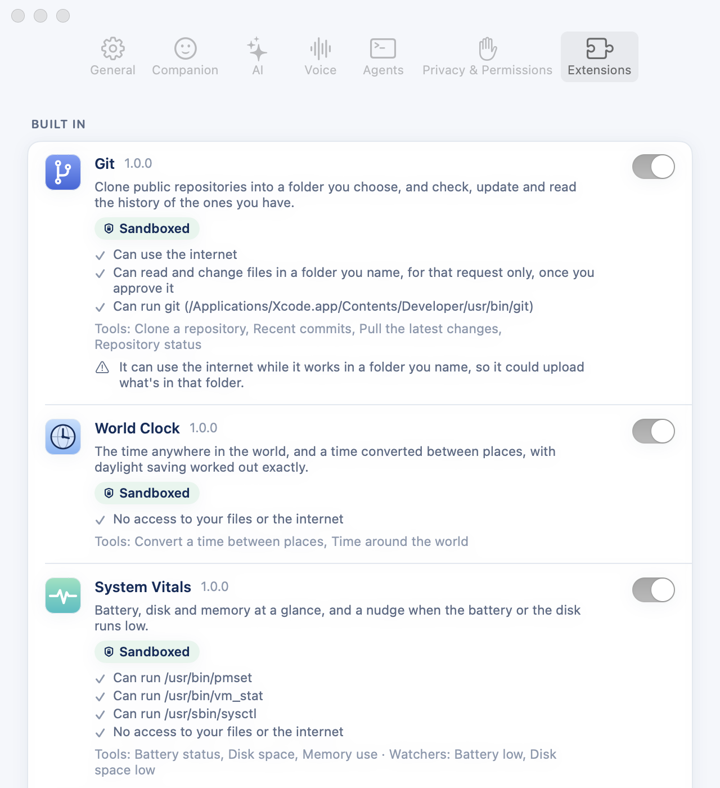</p>

## Agents and MCP

Sidefolk is also a small MCP server, so Claude Code, Codex or any MCP client can leave you a note, set
a reminder, watch something, tell you something or ask you a question.

- **Connect:** Settings › Agents › Connect. For Claude Code it adds a `sidefolk` server to
  `~/.claude.json`; for Codex an `[mcp_servers.sidefolk]` entry in `~/.codex/config.toml`. It shows every
  change first, saves a backup next to the file, and Disconnect removes only what it added.
- **What other agents can do:** save a note (tagged with the agent's name), set a reminder, watch a
  page, file or program (never a command), list and stop their own watches, notify you, ask you, and
  check status. Reading your notes or reminders always asks you first. Files, the clipboard, the web,
  commands, settings and extensions are not offered to them, and they can never answer an approval.
- **Claude Code sessions:** turn on "Notice when a session needs you" (it adds hooks to
  `~/.claude/settings.json`, with a backup) and the companion tells you when a session needs you or
  finishes; "Open session" brings its window forward.
- **Long commands:** install the `sidefolk` command (Settings › Agents), then
  `sidefolk run -- npm test`. The companion tells you when it ends, and when it fails, the last lines
  it printed.
- **Any other MCP client:** run `sidefolk mcp` over stdio, for example
  `{"command": "/Users/you/.local/bin/sidefolk", "args": ["mcp"]}`. Its name is shown as unverified.

<p align="center">
  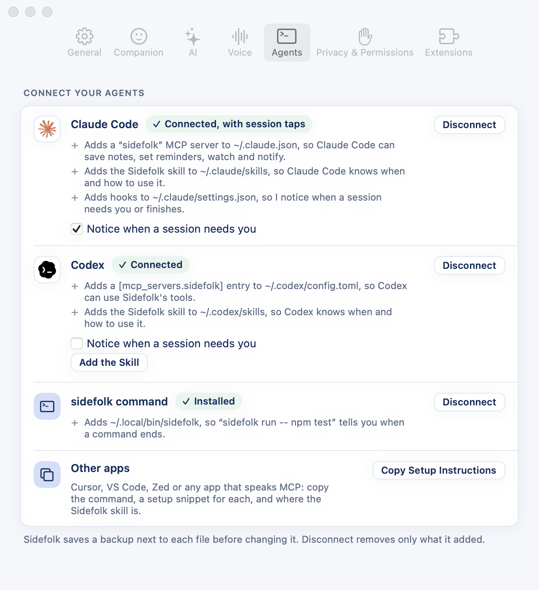
  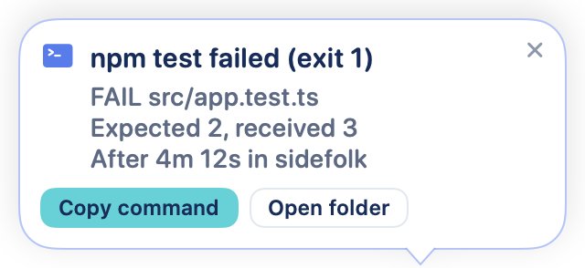
</p>

## Languages

Sidefolk speaks English, French, Spanish, German, Italian, Portuguese (Brazil), Japanese, Korean,
Chinese (Simplified) and Arabic, right to left. It follows your Mac's language; change it in
Settings › General.

<p align="center">
  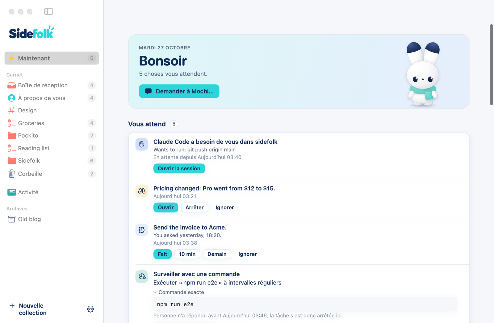
  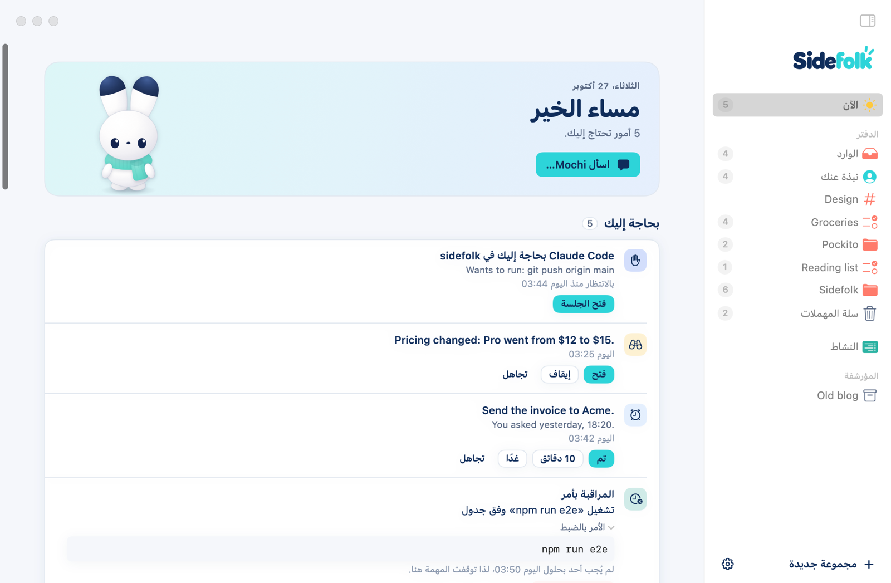
</p>

The quick understanding that works without AI ("remind me tomorrow at 9…") reads English only for
now. With an AI connected, ask in any language. The Save, Remind me… and Watch buttons work in every
language. The translations are new: corrections are welcome.

## What isn't done yet

- **No signed download and no automatic updates.** Signing and notarization are ready to run but need
  a Developer ID; updates will come with a proper update feed.
- **Apple silicon only**, and most testing so far has been on macOS 27.
- **Calendar, Mail, Music and Shortcuts** can't be reached yet. Neither can scheduled AI routines
  ("every weekday at 9, give me my open tasks") or a "what was I doing today" timeline.
- **Watches and live values run only while Sidefolk runs.** Reminders fall back to macOS notifications
  when it's quit. A folder with more than 20,000 items can't be watched.
- **Extensions** can use the whole internet or none of it (not chosen sites), can't keep an API key
  yet, and there is no extension directory to browse.
- **Not yet tried by hand:** voice with a real microphone (it was checked with recorded audio), a live
  ElevenLabs voice, Claude Code hooks in a real session, multiple displays and fullscreen apps, the
  notification permission prompt, and opening at login from /Applications.
- **New and lightly tested:** Apple Notes support (copying is the default, removing always asks), the
  extension builder, and the nine translations.

The full, current list is in [docs/STATUS.md](docs/STATUS.md).

## FAQ

**Do I need an AI subscription or an API key?**
No. Notes, reminders, watches, live values and search work without one. Add one when you want answers.

**Will it spend my Claude or ChatGPT quota?**
Only for requests that need AI. The hint under the box says "no AI" when Enter won't use any, and the
quick commands never do.

**Does it watch my screen or listen all the time?**
No. It never reads your screen or other apps' windows. The microphone is off unless you turned voice on
and are holding the key.

**Can it delete my files?**
It works only in folders you share with it, asks before changing things (unless you chose otherwise),
and "deleting" moves things to the Trash. Every action is in Activity, and most can be undone.

**What happens if a web page tries to give it instructions?**
Anything Sidefolk reads from outside (pages, files, notes, extension output) marks the request as
untrusted, and from then on anything that could change things or send data out asks you first, in
every mode. See [docs/SECURITY.md](docs/SECURITY.md).

**Does it change my Claude Code or Codex settings?**
Only when you click Connect, after showing you every change, with a backup next to each file.

**Intel Macs, Windows, Linux, iPhone?**
Not now. Sidefolk is a native Mac app built for Apple silicon.

**Does it work offline?**
Yes, everything that doesn't need AI or the web. A model in Ollama or LM Studio also works offline.

**Where is my data, and how do I get it out?**
In `~/Library/Application Support/Sidefolk`. Settings › Privacy & Permissions exports it all as JSON or
deletes it all.

**How much does it cost?**
<!-- FOUNDER: pricing -->Nothing is sold yet; this release is built from source.

**Why a rabbit?**
Mochi is the mascot. If you'd rather have the original robot, Spark or one of the folks, pick it in
Settings › Companion.

## Troubleshooting

- **Nothing happens on ⌘⇧Space:** another app may use that shortcut; change it in Settings › General.
- **"That needs AI, which isn't set up yet":** pick a provider in Settings › AI; local commands keep working.
- **Claude Code or Codex isn't found:** Settings › AI shows the command to install it; set a custom path
  if it's somewhere unusual. Codex must be signed in (`codex login` in Terminal).
- **An extension "didn't start":** run `sidefolk ext validate <folder>`; Settings › Extensions shows its
  last error. Diagnostics (logs without your content) export from Settings › Privacy & Permissions.
- **Reminders while the Mac sleeps:** the companion sleeps too; missed reminders appear when you're back.

## Develop

```sh
swift build                      # everything
make test                        # the test suite (Swift Testing), serially, about 45 s
make dev                         # debug app with its own data in build/dev-home (never your real data)
swift run sidefolk-render out/   # character contact sheets for visual review
SIDEFOLK_RESOURCES=$PWD/Resources swift run SidefolkApp --ui-snapshots /tmp/sf-ui   # every page, light and dark
swift run SidefolkApp --ui-snapshots /tmp/sf-fr --language fr   # the same in another language
swift scripts/launch-screenshots.swift   # rebuild docs/launch/screenshots from fresh snapshots
make strings                     # collect every string people read into the catalog
swift scripts/dev.swift snap     # snapshot the running debug app's windows (see AGENTS.md)
```

Read [AGENTS.md](AGENTS.md) before changing things. The plan and the decisions live in [docs/](docs):
[PRODUCT](docs/PRODUCT.md) · [ARCHITECTURE](docs/ARCHITECTURE.md) · [DECISIONS](docs/DECISIONS.md) ·
[SECURITY](docs/SECURITY.md) · [EXTENSIONS](docs/EXTENSIONS.md) · [CHARACTER](docs/CHARACTER.md) ·
[VOICE](docs/VOICE.md) · [STATUS](docs/STATUS.md) · [MACOS-NOTES](docs/MACOS-NOTES.md) ·
[RELEASE-NOTES](docs/RELEASE-NOTES.md). The launch kit is in [docs/launch/](docs/launch).

| Path | What lives there |
|------|------------------|
| `Sources/SidefolkCore/` | Everything that isn't UI: storage, Guard, tools, brain, time, watchers, bridge, extensions, skills, voice, the Mac's own apps |
| `Sources/SidefolkCharacter/` | The Core Animation rigs for every companion and folk, the icon renderer |
| `Sources/SidefolkApp/` | The app: companion window, Ask panel, bubbles, menu bar, Home, Settings, onboarding, voice |
| `Sources/sidefolk/` | The `sidefolk` command-line helper (mcp, run, hook, status, ext validate) |
| `Tests/` | Core and character tests |
| `extensions/` | Built-in and sample extensions |
| `skills/` | The `sidefolk-extension` skill for Claude Code and Codex |
| `Resources/` | Info.plist, icon, brand, localization, bundled skills, character sheets |
| `scripts/` | `build-app.sh` (assemble and sign the .app), `release.sh` (Developer ID, DMG, notarization), `dev.swift` (drive the debug app) |

### Release

`scripts/release.sh` runs the tests, builds, signs with the hardened runtime, makes a DMG, notarizes and
staples it. It needs two things that aren't in the repository:

```sh
export SIDEFOLK_SIGN_IDENTITY="Developer ID Application: Your Name (TEAMID)"
xcrun notarytool store-credentials sidefolk --apple-id you@example.com --team-id TEAMID
export SIDEFOLK_NOTARY_PROFILE=sidefolk
scripts/release.sh
```

`scripts/package.sh` makes the disk image alone, for an install on your own Mac.

On GitHub, **CI** builds and tests every push and pull request to `main`, and **Release** (Actions › Release ›
Run workflow) publishes a snapshot or, from a `v<version>` tag, a signed and notarized production release.
Secrets and settings: [docs/RELEASE.md](docs/RELEASE.md#github-actions).

## Licence, credits and trademarks

**Licence.** Sidefolk is © 2026 Ghassen Bargougui, all rights reserved ([LICENSE](LICENSE)). The code
is public to read; a licence for using and changing it hasn't been chosen yet.

**Built with** [GRDB.swift](https://github.com/groue/GRDB.swift) by Gwendal Roué and
[KeyboardShortcuts](https://github.com/sindresorhus/KeyboardShortcuts) by Sindre Sorhus (both MIT).
Service logos in Settings come from [LobeHub Icons](https://github.com/lobehub/lobe-icons) (MIT).
Weather data by [Open-Meteo.com](https://open-meteo.com) (CC BY 4.0). Full notices:
[THIRD_PARTY_NOTICES.md](THIRD_PARTY_NOTICES.md).

**Trademarks.** Sidefolk, Mochi and the Folk Family characters belong to Sidefolk's author. Claude and
Claude Code are trademarks of Anthropic; ChatGPT, Codex and OpenAI of OpenAI; Apple, Mac, macOS and
Apple Notes of Apple; other names and logos belong to their owners. They are used only to say which
service Sidefolk connects to. Sidefolk is not affiliated with or endorsed by any of them.
