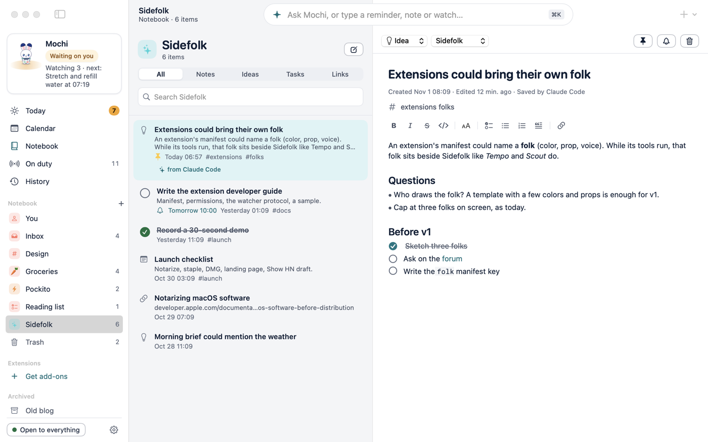

# Enhancing the notebook: a proposal (dev ideas, item 10)

The founder's note: "The notebook needs to be much more advanced, including improvements to its look, how it manages
things, and the features it provides to both the companion and the user." Too open to build as it stands, so this picks.

## What is there after items 8 and 9

Collections with their own name, icon, colour and order. Notes, ideas, tasks and links; pins, tags, Markdown, the Trash.
Reminders that belong to an item, and due dates on the Calendar. Agents can read a note in full, add to one and arrange collections.

## What's still thin

- **Tasks only live in their collection.** Nothing answers "what's due this week?" across all of them, except the Calendar.
- **Saving is easy, finding your way back isn't.** A note links to nothing, and a collection is a flat list.
- **One at a time.** Moving or finishing ten things is ten clicks; an agent's ten calls are ten approvals where it asks.
- **The list looks the same for everything:** a shopping list and a long essay share one row.

## Three directions

| | What it is | Cost | Risk |
|---|---|---|---|
| **A. Tasks that work** | A "Coming up" view across collections: late, today, this week, by due date. Bulk select: done, move, trash. Quick due dates when typing | Small | Low: all on what exists, nothing to migrate |
| **B. Notes that connect** | `[[links]]` between notes with backlinks, a checklist inside a note counted on its row, nested collections | Medium to large | Medium: linking changes the editor and search, and nesting touches every place a collection is named |
| **C. A look per kind** | A list collection reads as a checklist, an ideas one as cards, a long note with its first lines | Medium | Low to medium: only looks, but in four themes and RTL, and the founder should see it first |

## Recommendation

**A, then C, then decide on B from use.** A meets the most concrete need: it finishes what the due dates started, it needs
no new concept, and the companion gains straight away ("what's due this week?" has one answer). C is mostly the founder's
taste, so it should come as a sheet of pictures rather than as code. B is what makes a notebook "advanced" in the usual
sense, but it is the most to carry, and no note so far asks for it.

## Done now, since they fit any direction

- The Tasks tab puts what's due first, soonest first. Nothing else moves.
- `notes_update` takes `append`, so an agent can add to a note without sending all of it back.
- The gaps found while reading the founder's own notes: `notes_get`, loose collection names, and searching by a collection's name.

## For the founder to choose

1. Build A as the next step? *Recommended: yes.*
2. Pictures for C before any code? *Recommended: yes.*
3. Anything in B you already miss? It moves B up if so.

Not built, as this file asks: A's view, C and B all wait for that choice.
